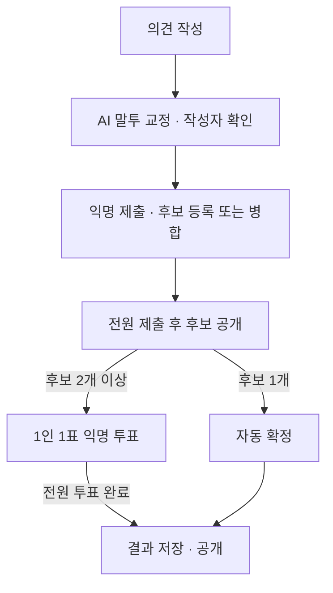
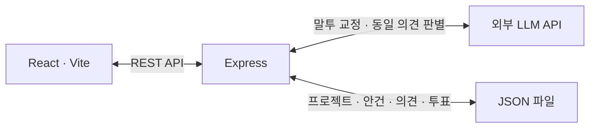

  <h1>속닥 (Sokdak)</h1>

  
<strong>의견은 자유롭게, 공개는 함께.</strong>

  

    팀 프로젝트와 동아리 회의에서 각자의 의견을 익명으로 모으고, 
    AI로 말투를 다듬고 동일한 의견을 묶어 함께 결정하는 웹 서비스입니다.
  

  

    <a href="https://github.com/Eine0322/oss-team5-sokdak"><strong>GitHub</strong></a>
    ·
    <a href="https://github.com/Eine0322/oss-team5-sokdak/issues"><strong>Issues</strong></a>
  

---

## Why Sokdak?

팀 회의나 단체 채팅에서는 먼저 나온 의견이 이후 논의의 기준이 되기 쉽습니다. 반대 의견을 내기 어렵고, 익명으로 적어도 말투나 자주 쓰는 표현 때문에 작성자를 짐작할 수 있습니다. 같은 제안이 여러 후보로 올라가면 표가 나뉘기도 합니다.

속닥에서는 모두가 제출할 때까지 의견을 비공개로 유지합니다. 작성자는 AI가 다듬은 문구를 직접 확인하고, 같은 제안은 하나의 후보로 묶어 팀이 선택할 수 있도록 합니다.

---

## Core Experience

---

## Main Features

### Project & Topic

- 프로젝트를 만들 때 참여 인원을 설정하고 참여 코드를 공유합니다.
- 팀원은 회원가입 없이 참여 코드와 닉네임으로 입장합니다.
- 프로젝트 안에서 여러 안건을 등록하고, 안건별 진행 상황과 결정 내역을 확인합니다.

### AI-assisted Opinion Writing

- 안건마다 의견을 하나씩 작성합니다. AI는 주장·근거·조건·수치를 유지하면서 말투를 중립적으로 다듬습니다.
- 작성자는 **내 의견**과 **AI의 내용 교정**을 비교합니다. 필요하면 문구를 수정하거나 다시 다듬은 뒤 **익명으로 제출하기**를 누릅니다.
- 전원 제출 전까지 다른 참여자의 의견 내용과 후보 수는 비공개입니다. 참여 현황은 확인할 수 있습니다.

### Opinion Merging

- 최종 제출된 문구를 같은 안건의 기존 후보와 비교합니다. 결론과 주요 조건이 같으면 기존 후보에 합칩니다. 조건이 다르거나 판단이 모호하면 새 후보로 등록합니다.
- **“토요일에 진행하자”**와 **“토요일에 하면 좋겠어요”**는 같은 후보로 묶습니다. **“토요일 오후 2시에 하자”**는 시각 조건이 있어 별도 후보로 등록합니다.
- 먼저 등록된 문구를 대표로 표시합니다. 작성자와 병합된 의견 수는 공개하지 않습니다.

### Anonymous Voting & Results

- 전원이 의견을 제출하면 후보를 한꺼번에 익명으로 공개합니다.
- 후보가 2개 이상이면 1인 1표로 익명 투표합니다. 전원 투표가 끝나면 후보별 득표수와 득표율을 공개하며, 최다 득표가 같으면 공동 1위로 표시합니다.
- 후보가 하나면 투표 없이 해당 의견을 결과로 확정합니다. 결과에는 자동 확정 사유를 표시합니다.

---

## Tech Stack

| Category | Technology |
| --- | --- |
| Frontend | React · Vite |
| Backend | Node.js · Express |
| API | REST API |
| Storage | 서버 JSON 파일 |
| AI | 외부 LLM API |
| Deployment | Docker · 영속 볼륨 |

---

## Architecture

Express 서버가 참여자 권한을 확인하고, 후보 공개 시점과 투표 단계를 관리합니다. LLM 호출은 서버에서 처리하며 API 키는 서버 환경 변수로 관리합니다. AI의 의견 판별 결과를 바탕으로 서버가 후보를 등록하거나 기존 후보에 연결합니다.

---

## Page Flow

| 화면 | 경로 | 주요 기능 |
| --- | --- | --- |
| 홈 | `/` | 프로젝트 만들기, 코드로 입장 |
| 프로젝트 생성 · 입장 | `/projects/new` · `/join/:code` | 참여 인원 설정, 닉네임 등록 |
| 프로젝트 대시보드 | `/projects/:code` | 참여 현황, 안건 목록 |
| 안건 등록 · 상세 | `/topics/new/:code` · `/topics/:topicId/:code` | 안건 등록, 진행 단계 확인 |
| 의견 작성 · 확인 | `/topics/:topicId/opinion/:code` | 원문과 AI 교정 문구 비교, 익명 제출 |
| 후보 공개 · 투표 | `/topics/:topicId/vote/:code` | 공개 후보 확인, 익명 투표 |
| 결과 | `/topics/:topicId/results/:code` | 투표 결과, 단일 후보 자동 확정 안내 |

---

## API Communication

PRD v1.1 기준 주요 API입니다.

| Method | Endpoint | Description |
| --- | --- | --- |
| POST | `/api/projects` | 프로젝트 생성 및 참여 코드 발급 |
| POST | `/api/projects/:code/participants` | 닉네임으로 프로젝트 입장 |
| POST | `/api/projects/:code/topics` | 안건 등록 |
| POST | `/api/topics/:topicId/opinions/me/normalize` | 작성자 의견의 말투 교정 |
| POST | `/api/topics/:topicId/opinions/me/confirm` | 의견 최종 제출, 후보 등록 또는 병합 |
| GET | `/api/topics/:topicId/opinions` | 전원 제출 전에는 참여 현황, 전원 제출 후에는 익명 후보 조회 |
| POST | `/api/topics/:topicId/votes` | 익명 투표 제출 |
| GET | `/api/topics/:topicId/results` | 투표 결과 또는 단일 후보 자동 확정 결과 조회 |

---

## Repository

| Repository | Description |
| --- | --- |
| [oss-team5-sokdak](https://github.com/Eine0322/oss-team5-sokdak) | 속닥 프로젝트 저장소 |

## Team

| GitHub | Role | Main Responsibilities |
| --- | --- | --- |
| [@Eine0322](https://github.com/Eine0322) | PM · 디자인 · 백엔드 | 프로젝트 생성·입장, 공통 서버, LLM 연동 |
| [@JJH-923](https://github.com/JJH-923) | 기획 · 디자인 · 프론트엔드 | 안건 등록, 의견 작성·확인·제출 |
| [@hyeon0403](https://github.com/hyeon0403) | 기획 · 디자인 · 프론트엔드 | 익명 후보 공개, 투표, 결과 화면 |

---

  <strong>속닥 (Sokdak)</strong> · 광운대학교 오픈소스프로그래밍 5팀

